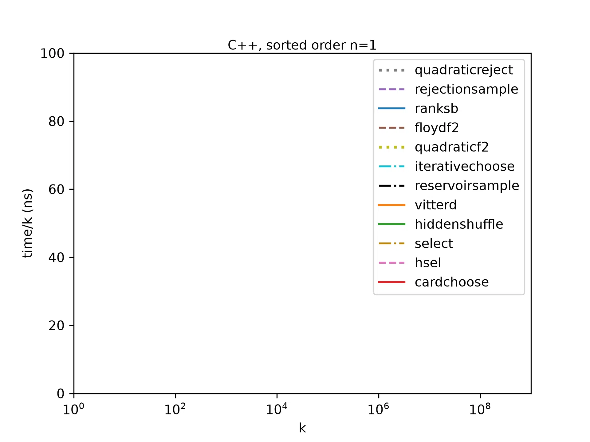

# Sampling without replacement

The problem of __sampling without replacement__: given integers _n_, _k_ such that 0 ≤ _k_ ≤ _n_,
return _k_ **distinct** nonnegative integers < _n_, choosing at random such that every possible
result is equally likely. One way to get a precise understanding of the problem is to look at the
simplest algorithm for solving it, via these [Python](python/algorithms/quadraticreject.py) or
[C++](cpp/quadraticreject.cpp) implementations.

This repository surveys algorithms for this problem. It implements eleven of them in Python, C++
and Rust, and benchmarks the C++ and Rust implementations over a wide range of _n_ and _k_, for
both sorted and random order output. The C++ implementations use only what the C++ standard
library provides; the Rust ones use Rust's standard library, whose hash tables and sort are much
faster.

No algorithm is close to the fastest everywhere, so a good implementation chooses between a few
algorithms based on _n_ and _k_. The [results](results.md) give the best such sets: in each case
the best set of three is never more than 1.2–1.9× slower than the fastest, while the best single
algorithm is somewhere 2.9–13× slower.

One of the algorithms, which I call cardchoose, I believe to be new; I first proposed it in
October 2018. It needs no memory beyond the output vector and runs in O(_k_ log _k_) time. Its
two ingredients, a Pólya urn and the stars-and-bars bijection, are classical mathematics; what I
have not found elsewhere is the urn run as a generator, or the two composed into a sampler (see
[prior art](priorart.md)). I would be glad to hear of any earlier description. Cardchoose belongs
to the best pair of algorithms in three of the four cases, and with a fast sort, as in Rust, it is
the fastest algorithm for sorted output over most of the range tested. With C++'s `std::sort`,
Nijenhuis and Wilf's RANKSB, which also needs no extra memory, is faster at most points where
_k_ ≤ _n_/2.

* [Guide to algorithms tested](algorithms.md)
* [Description of cardchoose](cardchoose.md)
* [Prior art](priorart.md)
* [Benchmark results](results.md)
* [Running this software](running.md)

Cardchoose in Python:

```python
def sorted_choose(n, k):
    "k distinct integers 0 <= x < n, sorted"
    t = n - k + 1
    d = [None] * k
    for i in range(k):
        r = random.randrange(t + i)
        if r < t:
            d[i] = r
        else:
            d[i] = d[r - t]
    d.sort()
    for i in range(k):
        d[i] += i
    return d
```




This is not an officially supported Google product.
