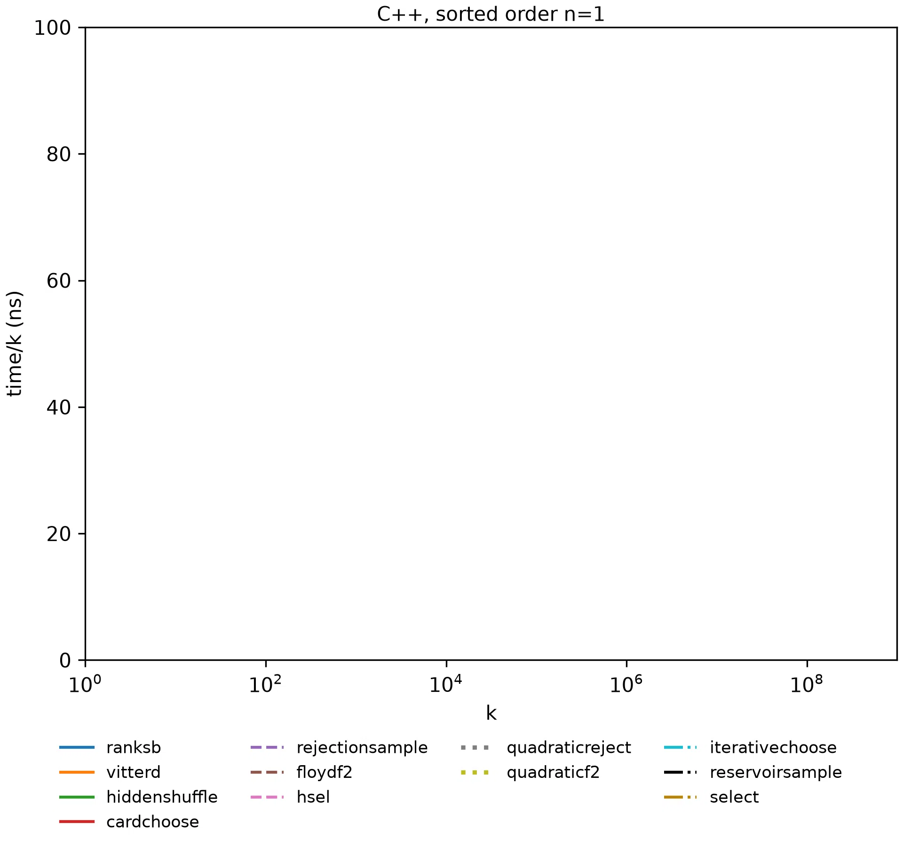

# Sampling without replacement

The problem of __sampling without replacement__: given integers _n_, _k_ such that 0 ≤ _k_ ≤ _n_,
return _k_ **distinct** nonnegative integers < _n_, choosing at random such that every possible
result is equally likely. One way to get a precise understanding of the problem is to look at the
simplest algorithm for solving it, via these [Python](python/algorithms/quadraticreject.py) or
[C++](cpp/quadraticreject.cpp) implementations.

This repository surveys algorithms for this problem. It implements twelve of them in Python, C++
and Rust, and benchmarks the C++ and Rust implementations over a wide range of _n_ and _k_, for
both sorted and random order output. The C++ implementations use only what the C++ standard
library provides; the Rust ones use Rust's standard library, whose hash tables and sort are much
faster.

No algorithm is close to the fastest everywhere, so a good implementation chooses between a few
algorithms based on _n_ and _k_. [Choosing algorithms](choosing.md) gives the best such sets: in
each case the best set of three is never more than 1.2–1.7× slower than the fastest, while the
best single algorithm is somewhere 2.9–13× slower.

* [Guide to algorithms tested](algorithms.md)
* [Benchmark results](results.md)
* [Explorer](https://ciphergoth.github.io/sansreplace/): pick _n_ and _k_ and compare every algorithm there
* [Choosing algorithms](choosing.md)
* Pairwise comparisons: [ratio of times](results/latest/pairwise-ratio.md),
  [difference in time/_k_](results/latest/pairwise-difference.md)
* [Running this software](running.md)

## Cardchoose

This repository also presents a (I believe) novel algorithm for this purpose, Cardchoose. It is to
my knowledge the only algorithm which is both simple and performs within an acceptable distance (in
time per output) of all other solutions across the entire parameter space tested. It needs no
memory beyond the output vector and runs in O(_k_ log _k_) time.

Cardchoose in Python:

```python
def sorted_choose(n, k):
    "k distinct integers 0 <= x < n, sorted"
    t = n - k + 1
    d = [None] * k
    for i in range(k):
        r = random.randrange(t + i)
        if r < t:
            d[i] = r
        else:
            d[i] = d[r - t]
    d.sort()
    for i in range(k):
        d[i] += i
    return d
```

* [Description of Cardchoose](cardchoose.md)
* [Prior art](priorart.md)


