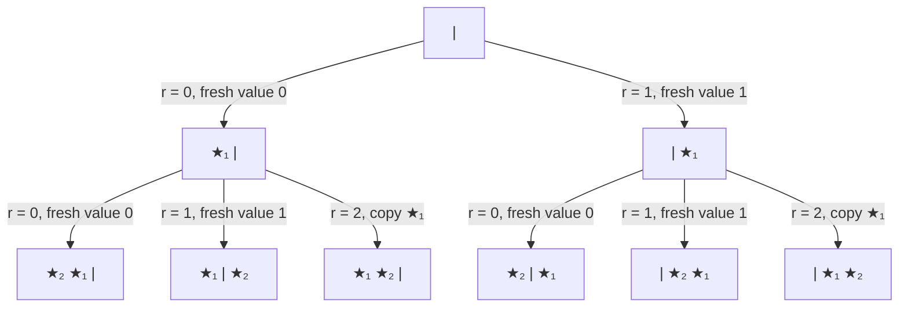

# Cardchoose algorithm

Algorithm | Python | C++ | Order guarantee | Data structures | Time
----|----|----|----|----|----
[Cardchoose](cardchoose.md) | [Python](python/algorithms/cardchoose.py) | [C++](cpp/cardchoose.cpp) | Sorted | none | _k_ log _k_

Cardchoose returns _k_ distinct integers from 0 to _n_-1, with every _k_-element subset equally
likely. The only storage is the output list. Everything except the final sort is O(_k_), and the
loop that fills the list has no searches and no inner loops.

```python
def sorted_choose(n, k):
    "k distinct integers 0 <= x < n, sorted"
    t = n - k + 1
    d = [None] * k
    for i in range(k):
        r = random.randrange(t + i)
        if r < t:
            d[i] = r
        else:
            d[i] = d[r - t]
    d.sort()
    for i in range(k):
        d[i] += i
    return d
```

## A subset is a row of stars and bars

Write the numbers 0 to _n_-1 in a row, marking each chosen number as a star and each unchosen one
as a bar. For _n_ = 7, _k_ = 3 and the subset {1, 2, 5}:

```
number:  0 1 2 3 4 5 6
row:     | ★ ★ | | ★ |
```

A row of _k_ stars and _n_-_k_ bars is exactly a _k_-element subset: the stars' positions are the
chosen numbers.

## A row of stars and bars is a multiset

Instead of its position, describe each star by its **value**, the number of bars to its left:

```
row:     | ★ ★ | | ★ |
value:     1 1     3
```

A value can be anything from 0 (before all the bars) to
_n_-_k_ (after all of them), so there are _t_ = _n_-_k_+1 possible values, and stars can share a
value when they sit in the same gap between bars.

The values of the stars form a multiset: a bag of _k_ values, with repeats allowed. This is a
bijection between _k_-element subsets of {0, …, _n_-1} and _k_-element multisets drawn from the
_t_ values {0, …, _n_-_k_}. Going one way, read off each star's value. Going back, the multiset says how many stars have each value, that is, how
many stars go in each gap, and that rebuilds the row. The two directions undo each other, so each
subset corresponds to exactly one multiset and each multiset to exactly one subset.

In code, the way back is: sort the multiset, then add each star's index to its value, because a
star's position is its bars to the left plus its stars to the left:

```
sorted values:  1 1 3
+ index:        0 1 2
positions:      1 2 5
```

That is the last three lines of the code. Because the correspondence is a bijection, choosing a
multiset uniformly at random and converting it gives a subset chosen uniformly at random: each
subset is reached from exactly one multiset. So what remains is to pick a multiset of _k_ values
from _t_ **uniformly at random**.

## The obvious way to pick a multiset is biased

Drawing _k_ values independently from 0 to _t_-1 does not give a uniform multiset. With _t_ = 2,
_k_ = 2, the bag {0, 1} comes up half the time, because it can arrive as 0,1 or as 1,0, while
{0, 0} and {1, 1} get a quarter each. Independent draws favour variety; we need to favour repeats,
by exactly the right amount.

## The fix is to let earlier draws vote

For the _i_-th draw, choose uniformly among _t_+_i_ options: the _t_ fresh values, plus the _i_
values already in the list. That is `randrange(t + i)`. If `r < t`, it's a fresh value. Otherwise
`r - t` picks one of the earlier entries, and we copy it: `d[r - t]`. A value that has already
been drawn once is now twice as likely to be drawn again, a value drawn twice is three times as
likely, and so on.

The list is never searched or modified in place; copies go on the end like everything else. So
each iteration is one random number, one comparison and one write, with no inner loop.

In the picture, this is dropping the new star into a uniformly random gap of the current row.
Before the _i_-th star there are _t_-1+_i_ things in the row, so _t_+_i_ gaps, and the gaps with
_b_ bars to the left are the _c_+1 gaps around the _c_ stars that already have value _b_: one
fresh option, plus one for each existing star with that value.

## Why that's exactly fair

Tag each star with the number of the draw that placed it, and be specific about which gap each
draw uses: a fresh value _b_ goes in the gap just after bar _b_ (at the start of the row for
_b_ = 0), and a copy of star _j_ goes in the gap just after star _j_. Then different draws put
the new star in different gaps, and a tagged row records its whole history: pull out the
highest-tagged star, and its left neighbour says whether it was fresh (a bar, or nothing) or a
copy (a star, and which one).

Here is every possible run for _t_ = 2, _k_ = 2, one bar and two stars:



Every path has the same probability, 1/2 × 1/3, and the six leaves are the six tagged rows:
three ways to place two stars around a bar, times two ways to tag them. In general there are
_t_ × (_t_+1) × … × (_t_+_k_-1) paths, each with probability 1/_t_ × 1/(_t_+1) × … ×
1/(_t_+_k_-1), and the same number of tagged rows, so every tagged row is equally likely. Each
untagged row has exactly _k_! taggings, so every untagged row is equally likely, which is to say
every multiset, which is to say every subset. In the tree, each of the three untagged rows
`★ ★ |`, `★ | ★` and `| ★ ★` is the leaf of two paths, so each has probability 1/3.

## Worked example

_n_ = 7, _k_ = 3, so _t_ = 5 and we start with four bars: `| | | |`.

draw | `randrange` | `r` | meaning | `d` | row
----|----|----|----|----|----
0 | 5 | 1 | fresh value 1 | `[1]` | `\| ★ \| \| \|`
1 | 6 | 3 | fresh value 3 | `[1, 3]` | `\| ★ \| \| ★ \|`
2 | 7 | 5 | 5 ≥ _t_, copy `d[0]` = 1 | `[1, 3, 1]` | `\| ★ ★ \| \| ★ \|`

Sort: `[1, 1, 3]`. Add indices: `[1, 2, 5]`. Reading the final row left to right, the stars sit at
positions 1, 2 and 5, with the unchosen numbers 0, 3, 4 and 6 as the bars.

## Random order

For unsorted output, `random_choose` runs the sorted version and then shuffles the result, which
costs one extra random number per element.

How this relates to earlier work is in [prior art](priorart.md).
