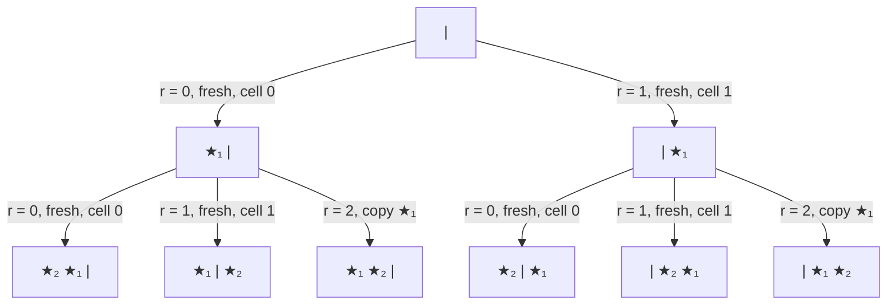

# Cardchoose algorithm

Algorithm | Python | C++ | Rust | Order guarantee | Data structures | Time
----|----|----|----|----|----|----
[Cardchoose](cardchoose.md) | [Python](python/algorithms/cardchoose.py) | [C++](cpp/cardchoose.cpp) | [Rust](rust/src/algorithms/cardchoose.rs) | Sorted | none | _k_ log _k_

Cardchoose returns _k_ distinct integers from 0 to _n_-1, with every _k_-element subset equally
likely. The only storage is the output list. Everything except the final sort is O(_k_), and the
loop that fills the list has no searches and no inner loops.

```python
def sorted_choose(n, k):
    "k distinct integers 0 <= x < n, sorted"
    t = n - k + 1
    d = [None] * k
    for i in range(k):
        r = random.randrange(t + i)
        if r < t:
            d[i] = r
        else:
            d[i] = d[r - t]
    d.sort()
    for i in range(k):
        d[i] += i
    return d
```

## A subset is a row of stars and bars

Write the numbers 0 to _n_-1 in a row, marking each chosen number as a star and each unchosen one
as a bar. For _n_ = 7, _k_ = 3 and the subset {1, 2, 5}:

```
number:  0 1 2 3 4 5 6
row:     | ★ ★ | | ★ |
```

A row of _k_ stars and _n_-_k_ bars is exactly a _k_-element subset: the stars' positions are the
chosen numbers.

## A row of stars and bars is a multiset

Think of the spaces between bars, including the space at each end, as **cells**, numbered from 0,
as Feller does for occupancy problems (see [prior art](priorart.md)). Instead of its position,
describe each star by its **cell number**, the number of bars to its left:

```
row:     | ★ ★ | | ★ |
cell:      1 1     3
```

A cell number can be anything from 0 (before all the bars) to _n_-_k_ (after all of them), so
there are _t_ = _n_-_k_+1 cells, and stars can share a cell.

The cell numbers of the stars form a multiset: a bag of _k_ numbers, with repeats allowed. This is
a bijection between _k_-element subsets of {0, …, _n_-1} and _k_-element multisets drawn from the
_t_ cell numbers {0, …, _n_-_k_}. Going one way, read off each star's cell number. Going back, the
multiset says how many stars go in each cell, and that rebuilds the row. The two directions undo
each other, so each subset corresponds to exactly one multiset and each multiset to exactly one
subset.

In code, the way back is: sort the multiset, then add each star's index to its cell number,
because a star's position is its bars to the left plus its stars to the left:

```
sorted cells:   1 1 3
+ index:        0 1 2
positions:      1 2 5
```

That is the last three lines of the code. Because the correspondence is a bijection, choosing a
multiset uniformly at random and converting it gives a subset chosen uniformly at random: each
subset is reached from exactly one multiset. So what remains is to pick a multiset of _k_ cell
numbers from _t_ **uniformly at random**.

## The obvious way to pick a multiset is biased

Putting each of _k_ stars in a cell chosen independently from 0 to _t_-1 does not give a uniform
multiset. With _t_ = 2, _k_ = 2, the bag {0, 1} comes up half the time, because it can arrive as
0,1 or as 1,0, while {0, 0} and {1, 1} get a quarter each. Independent draws favour variety; a
fair draw must favour repeats, by exactly the right amount.

## Each new star goes in a random slot

Build the row one star at a time, starting from the _t_-1 bars alone, and put each new star in a
uniformly random slot of the row so far: a place between two neighbouring symbols, or at either
end. With _i_ stars already placed, the row holds _t_-1+_i_ things, so it has _t_+_i_ slots. Name
each slot by what is just to its left:

* The slot at the start of the row, and the slot just after each bar. There are _t_ of these, and a
  star placed in the one after bar _b_, or at the start for _b_ = 0, goes in cell _b_. These are
  the **fresh** slots.
* The slot just after each star. There are _i_ of these, and a star placed in one goes in the same
  cell as its left neighbour. These are the **copy** slots.

For example, with _t_ = 4, so three bars, and two stars already placed, `d = [1, 3]`, there are
six slots, each marked `∘` here with the `r` that picks it above and the cell it gives below:

```
r:       0     1     4     2     3     5
row:     ∘  |  ∘  ★₀ ∘  |  ∘  |  ∘  ★₁ ∘
cell:    0     1     1     2     3     3
```

That is the loop. `randrange(t + i)` picks a slot. If `r < t`, it is a fresh slot, and the new
star goes in cell `r`. Otherwise `r - t` picks one of the stars already placed, and the new star
goes in its cell, `d[r - t]`. The list `d` holds cell numbers in the order they were drawn, so the
copy is a single index lookup: one random number, one comparison and one write per star, with no
search.

A cell that already holds _c_ stars owns _c_+1 slots: one fresh slot, and one after each of
those stars. So a cell holding one star is now twice as likely to get the next one as an empty
cell, a cell holding two three times as likely, and so on. The slots are the balls of a Pólya urn
(see [prior art](priorart.md)): the _t_ fresh slots are _t_ balls, one of each colour, and each
star adds a copy slot to its cell, as each draw adds a ball of the colour drawn. That is how
repeats get favoured. The next section shows it is by exactly the right amount.

## Why that's exactly fair

Tag each star with the number of the draw that placed it. Different values of `r` put the new
star in different slots, so a tagged row records its whole history: pull out the highest-tagged
star, and its left neighbour says which slot it went in, so whether it was fresh (a bar, or
nothing) or a copy (a star, and which one). Repeat to recover every draw.

Here is every possible run for _t_ = 2, _k_ = 2, one bar and two stars:



Every path has the same probability, 1/2 × 1/3, and the six leaves are the six tagged rows:
three ways to place two stars around a bar, times two ways to tag them. In general there are
_t_ × (_t_+1) × … × (_t_+_k_-1) paths, each with probability 1/_t_ × 1/(_t_+1) × … ×
1/(_t_+_k_-1), and the same number of tagged rows, so every tagged row is equally likely. Each
untagged row has exactly _k_! taggings, so every untagged row is equally likely, which is to say
every multiset, which is to say every subset. In the tree, each of the three untagged rows
`★ ★ |`, `★ | ★` and `| ★ ★` is the leaf of two paths, so each has probability 1/3.

## Worked example

_n_ = 7, _k_ = 3, so _t_ = 5 and there are four bars to start with: `| | | |`.

draw | `randrange` | `r` | meaning | `d` | row
----|----|----|----|----|----
0 | 5 | 1 | fresh, cell 1 | `[1]` | `\| ★ \| \| \|`
1 | 6 | 3 | fresh, cell 3 | `[1, 3]` | `\| ★ \| \| ★ \|`
2 | 7 | 5 | 5 ≥ _t_, copy `d[0]` = 1 | `[1, 3, 1]` | `\| ★ ★ \| \| ★ \|`

Sort: `[1, 1, 3]`. Add indices: `[1, 2, 5]`. Reading the final row left to right, the stars sit at
positions 1, 2 and 5, with the unchosen numbers 0, 3, 4 and 6 as the bars.

## Random order

For unsorted output, `random_choose` runs the sorted version and then shuffles the result, which
costs one extra random number per element.

How this relates to earlier work is in [prior art](priorart.md).
