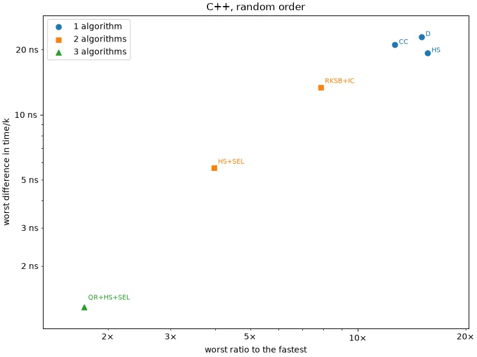
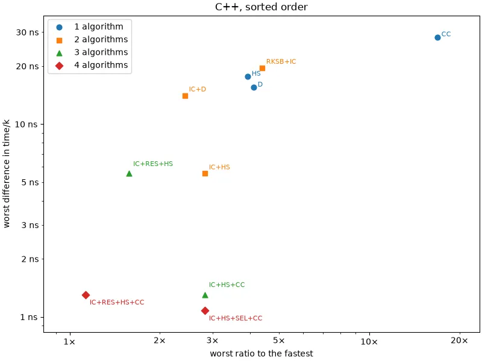
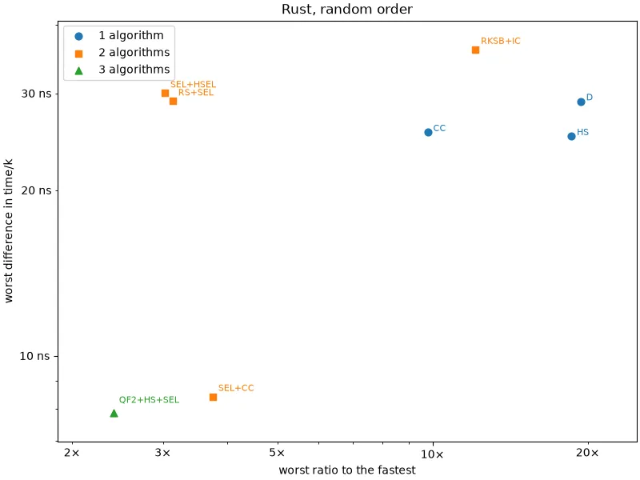
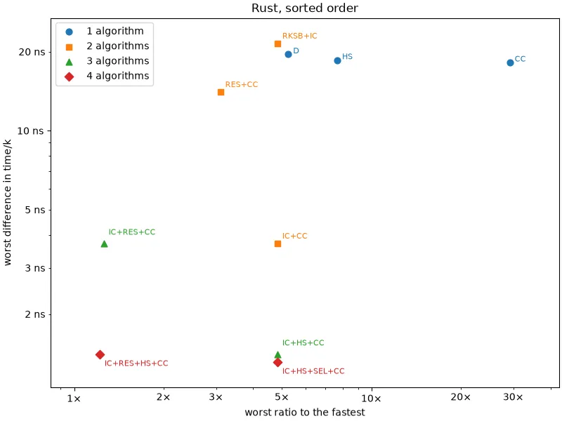

# Choosing algorithms

This page uses the [benchmark results](results.md).

No single algorithm is close to the fastest everywhere, so a good implementation will implement
several and choose between them based on _n_ and _k_. For each language and order, the tables give
the set of one, two or three algorithms that comes closest to the fastest of all of them at every
point with _k_ ≥ 10, if each point uses the fastest algorithm in the set. This assumes the best
choice is made at every point; an implementation has to choose by a rule, such as a threshold on
_n_/_k_. Vitter's Algorithm D is itself two algorithms, since it switches to Algorithm A once
_n_ ≤ 13 _k_, so wherever the best set includes it, the tables also give the best set without it.

There are two ways to measure how close a set comes to the fastest, and each has a flaw:

* **Ratio**: the largest factor by which the set is slower than the fastest. Its worst case is
  often at a tiny _k_, where the stakes are tiny too. The best two algorithms for C++ random
  output by this measure are 4.80× slower than the fastest at _n_ = 2,178,309, _k_ = 34, but that
  is 428 ns against 89 ns, only 339 ns more per call.
* **Difference**: the most the set's time/_k_ exceeds the fastest's, which is the cost per number
  output. This discounts tiny _k_, but ignores large relative losses where everything is cheap.
  The best three algorithms for C++ sorted output by this measure are only 1.31 ns per number
  slower than the fastest at worst, but at _n_ = _k_ = 5,702,887 that makes them 2.82× slower:
  9.5 ms against 3.4 ms.

What a caller probably wants is somewhere in between: being a few times slower doesn't matter on
a call that takes nanoseconds, but does on one that takes milliseconds. So I give the
best sets by each measure, each with its worst ratio and worst difference, which needn't occur at
the same point. Generated by [`python/cover`](python/cover) `--measure ratio` and
`--measure difference`.

## Best by ratio

| | best 1 | best 2 | best 3 |
|---|---|---|---|
| C++, random order | `cardchoose` 20.97× / 32.1ns | `select` + `cardchoose` 4.80× / 14.6ns | `quadraticf2` + `hiddenshuffle` + `select` 2.48× / 6.20ns |
| C++, sorted order | `hiddenshuffle` 3.92× / 17.7ns | `iterativechoose` + `vitterd` 2.42× / 14.1ns _no D:_ `iterativechoose` + `hiddenshuffle` 2.82× / 5.54ns | `iterativechoose` + `reservoirsample` + `hiddenshuffle` 1.58× / 5.54ns |
| Rust, random order | `cardchoose` 9.78× / 25.5ns | `select` + `hsel` 3.02× / 30.0ns | `quadraticf2` + `hiddenshuffle` + `select` 2.41× / 7.87ns |
| Rust, sorted order | `vitterd` 5.25× / 19.5ns _no D:_ `hiddenshuffle` 7.67× / 18.6ns | `reservoirsample` + `cardchoose` 3.10× / 14.0ns | `iterativechoose` + `reservoirsample` + `cardchoose` 1.26× / 3.72ns |

## Best by difference

| | best 1 | best 2 | best 3 |
|---|---|---|---|
| C++, random order | `hiddenshuffle` 24.09× / 25.4ns | `hiddenshuffle` + `select` 5.00× / 9.44ns | `quadraticf2` + `hiddenshuffle` + `select` 2.48× / 6.20ns |
| C++, sorted order | `vitterd` 4.11× / 15.5ns _no D:_ `hiddenshuffle` 3.92× / 17.7ns | `iterativechoose` + `hiddenshuffle` 2.82× / 5.54ns | `iterativechoose` + `hiddenshuffle` + `cardchoose` 2.82× / 1.31ns |
| Rust, random order | `hiddenshuffle` 18.58× / 25.1ns | `select` + `cardchoose` 3.75× / 8.43ns | `quadraticf2` + `hiddenshuffle` + `select` 2.41× / 7.87ns |
| Rust, sorted order | `cardchoose` 29.18× / 18.2ns | `iterativechoose` + `cardchoose` 4.83× / 3.72ns | `iterativechoose` + `hiddenshuffle` + `cardchoose` 4.83× / 1.41ns |

## The trade-off

For each language and order, the scattergram plots sets of one, two or three algorithms, by their
worst ratio and worst difference, both on log scales; down and to the left is better. It shows
every set that no other set of the same size beats on both measures, both among all sets and among
sets without `vitterd`, so it includes everything in the tables above and the compromises between
them. It also shows `cardchoose`, `hiddenshuffle` and `vitterd` on their own, which are never far
from the fastest by difference, and `ranksb` with `iterativechoose`, which Nijenhuis and Wilf
pair. Generated by [`python/pareto`](python/pareto).

The labels abbreviate the algorithms: CC is `cardchoose`, D is `vitterd`, F2 is `floydf2`, HS is
`hiddenshuffle`, HSEL is `hsel`, IC is `iterativechoose`, QF2 is `quadraticf2`, QR is
`quadraticreject`, RES is `reservoirsample`, RKSB is `ranksb`, RS is `rejectionsample` and SEL is
`select`.

With sorted output, in both languages, four algorithms are each the fastest in their own region:
`cardchoose` for small _k_, `hiddenshuffle` for large _k_ when _n_ is much larger,
`iterativechoose` where _k_/_n_ is large, and `reservoirsample` near _k_ = _n_. (`select` is the
fastest at some points too, but never by more than 1.12× in C++ or 1.22× in Rust.) Every set of
three has to leave one region to a slower algorithm, so the best three by ratio and the best three
by difference are different sets, and no set of three comes between them. But all four of
`iterativechoose`, `reservoirsample`, `hiddenshuffle` and `cardchoose` together are never more than
1.13× slower than the fastest in C++, or 1.22× in Rust, while being no more per number slower than
the best three by difference: 1.31 ns in C++ and 1.41 ns in Rust. So for sorted output the
scattergrams also show sets of four.
