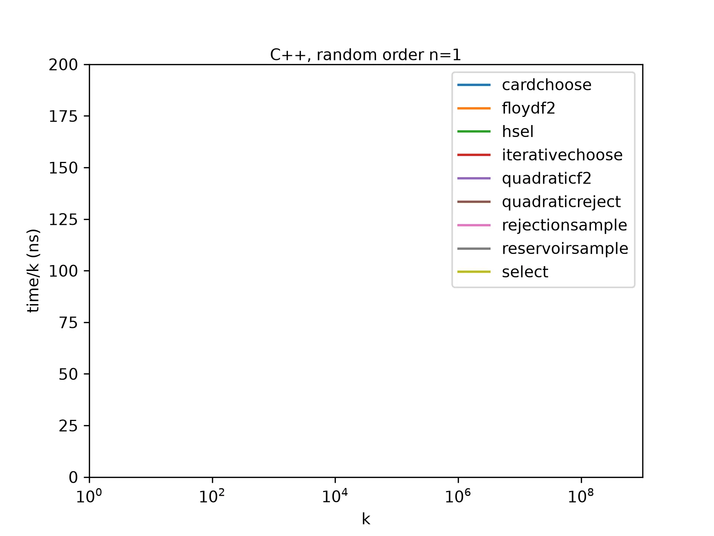
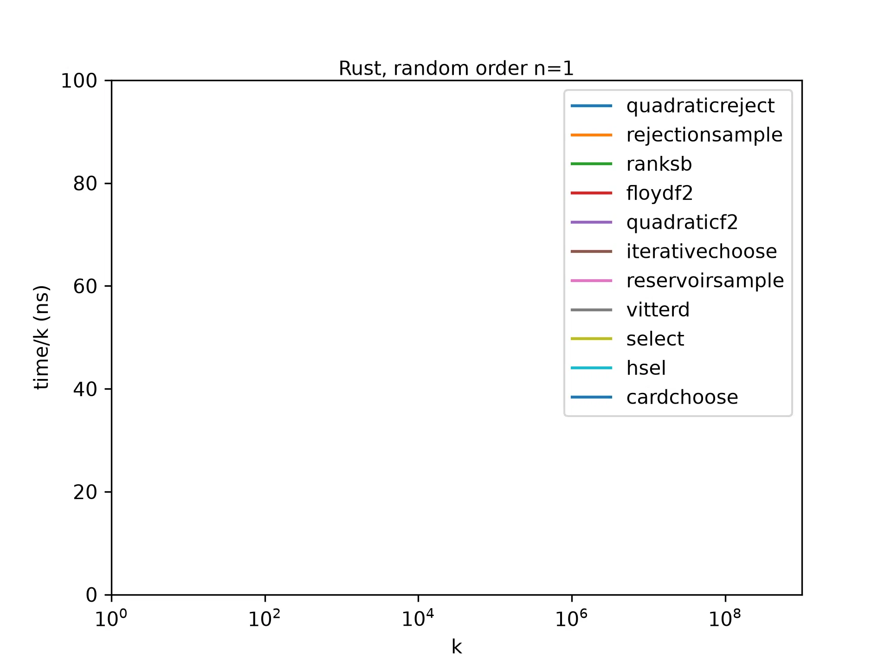
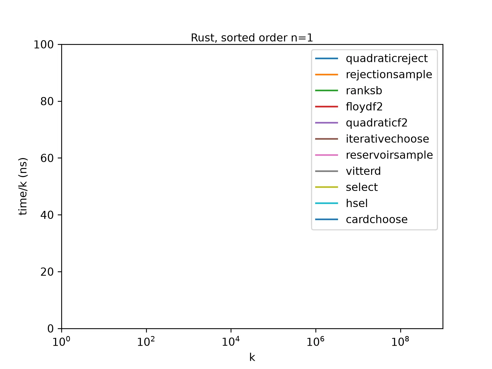

# Results

These results were measured on an Apple M4 MacBook Pro with 16GB of memory, using clang 21.1 and
rustc 1.98, for values of _n_ and _k_ that are Fibonacci numbers, with _k_ at most 102,334,155
(the 40th Fibonacci number). [Full results](results/latest/)

Each algorithm is timed in its own run, and its CSVs record the commit and setup it was timed
with. Hidden Shuffle was timed a few hours after the others, on the same setup.

Since both _n_ and _k_ affect the performance, we compare algorithms
using an animated graph. For each frame, we fix the value of _n_ and
graph the performance of each algorithm for various values of _k_;
we graph time/_k_ to show the cost in ns per number we output. Since
we are plotting a linear/log graph of time/_k_, the _k_ log _k_
performance of `cardchoose` is visible as a straight line.

## Choosing algorithms to cover every case

No single algorithm is close to the fastest everywhere, so a good implementation will implement
several and choose between them based on _n_ and _k_. For each language and order, the table
gives the set of one, two or three algorithms that comes closest to the fastest of all of them
at every point with _k_ ≥ 10, if each point uses the fastest algorithm in the set, and the
largest factor by which that set is slower than the fastest. This assumes the best choice is made
at every point; an implementation has to choose by a rule, such as a threshold on _n_/_k_.
Vitter's Algorithm D is itself two algorithms, since it switches to Algorithm A once _n_ ≤ 13 _k_,
so wherever the best set includes it, the table also gives the best set without it. Generated by
[`python/cover`](python/cover).

| | best 1 | best 2 | best 3 |
|---|---|---|---|
| C++, random order | `cardchoose` 12.35× | `select` + `cardchoose` 3.01× | `quadraticf2` + `hiddenshuffle` + `select` 1.82× |
| C++, sorted order | `vitterd` 2.88× _no D:_ `hiddenshuffle` 3.62× | `iterativechoose` + `hiddenshuffle` 1.72× | `iterativechoose` + `hiddenshuffle` + `cardchoose` 1.26× |
| Rust, random order | `hsel` 12.95× | `hiddenshuffle` + `select` 3.00× | `quadraticreject` + `hiddenshuffle` + `select` 1.47× |
| Rust, sorted order | `vitterd` 6.17× _no D:_ `hiddenshuffle` 8.09× | `reservoirsample` + `cardchoose` 2.23× | `iterativechoose` + `reservoirsample` + `cardchoose` 1.53× |

## Each algorithm

The table gives, for each algorithm, its median and worst time as a multiple of the fastest of all
the algorithms, over the points with _k_ ≥ 10. We stop timing an algorithm at a value of _k_, and
all larger ones, once a single call takes more than 20 seconds. Where that happened, we don't know
its worst case, so it is shown as ?, with the smallest _k_ it was not timed at, and its median
covers only the points it was timed at; for the quadratic algorithms, that is only the smaller
values of _k_. Generated by
`python/summarise results/latest --markdown --group` followed by all twelve algorithms.

| | C++, random | C++, sorted | Rust, random | Rust, sorted |
|---|---|---|---|---|
| `quadraticreject` | 15.0× / ? not timed from k=1.2×105 | 13.7× / ? not timed from k=1.2×105 | 4.15× / ? not timed from k=3.2×105 | 4.10× / ? not timed from k=3.2×105 |
| `rejectionsample` | 3.91× / ? not timed from k=6.3×107 | 4.74× / ? not timed from k=6.3×107 | 2.17× / ? not timed from k=2.4×107 | 2.36× / ? not timed from k=2.4×107 |
| `ranksb` | 1.66× / 33.8× | 1.49× / 145× | 2.89× / ? not timed from k=1.0×108 | 1.80× / 594× |
| `floydf2` | 4.08× / ? not timed from k=1.0×108 | 4.77× / ? not timed from k=1.0×108 | 2.39× / 41.2× | 2.69× / 350× |
| `quadraticf2` | 18.3× / ? not timed from k=5.1×105 | 16.9× / ? not timed from k=5.1×105 | 20.4× / ? not timed from k=5.1×105 | 20.5× / ? not timed from k=5.1×105 |
| `iterativechoose` | 29.8× / 2.7×107× | 34.0× / 1.5×107× | 65.1× / 4.5×107× | 68.6× / 2.0×107× |
| `reservoirsample` | 31.8× / 2.6×107× | 38.7× / 1.5×107× | 68.3× / 4.6×107× | 71.5× / 2.3×107× |
| `vitterd` | 2.38× / 12.5× | 2.41× / 2.88× | 3.42× / 21.3× | 2.55× / 6.17× |
| `hiddenshuffle` | 1.19× / 15.7× | 1.00× / 3.62× | 2.02× / 24.2× | 1.14× / 8.09× |
| `select` | 2.50× / 3.8×106× | 6.44× / 3.0×106× | 1.91× / 6.7×106× | 4.06× / 8.1×105× |
| `hsel` | 3.47× / 17.0× | 4.90× / 37.0× | 1.71× / 12.9× | 2.23× / 63.2× |
| `cardchoose` | 2.02× / 12.3× | 1.77× / 7.70× | 1.66× / 14.6× | 1.01× / 18.4× |

The quadratic algorithms are the fastest for small _k_, and `select`, `iterativechoose` and
`reservoirsample` for small _n_/_k_, but each is very slow elsewhere. The rest run in O(_k_) or
O(_k_ log _k_) time and differ by smaller factors; their worst cases are where _k_/_n_ is large, where
the O(_n_) algorithms win.

A ratio overstates differences where both times are small. The next table gives, for each
algorithm, the most its time/_k_ exceeds that of the fastest of all the algorithms, per number
output, over the same points, with ? as before. Generated by `python/summarise results/latest
--markdown-excess --group` followed by all twelve algorithms.

| | C++, random | C++, sorted | Rust, random | Rust, sorted |
|---|---|---|---|---|
| `quadraticreject` | ? not timed from k=1.2×105 | ? not timed from k=1.2×105 | ? not timed from k=3.2×105 | ? not timed from k=3.2×105 |
| `rejectionsample` | ? not timed from k=6.3×107 | ? not timed from k=6.3×107 | ? not timed from k=2.4×107 | ? not timed from k=2.4×107 |
| `ranksb` | 105ns | 107ns | ? not timed from k=1.0×108 | 193ns |
| `floydf2` | ? not timed from k=1.0×108 | ? not timed from k=1.0×108 | 106ns | 107ns |
| `quadraticf2` | ? not timed from k=5.1×105 | ? not timed from k=5.1×105 | ? not timed from k=5.1×105 | ? not timed from k=5.1×105 |
| `iterativechoose` | 97.3ms | 99.5ms | 146ms | 131ms |
| `reservoirsample` | 95.8ms | 95.8ms | 149ms | 149ms |
| `vitterd` | 23.1ns | 13.9ns | 25.6ns | 19.1ns |
| `hiddenshuffle` | 19.9ns | 14.2ns | 21.7ns | 15.6ns |
| `select` | 13.9ms | 19.8ms | 21.8ms | 5.32ms |
| `hsel` | 119ns | 240ns | 35.4ns | 42.3ns |
| `cardchoose` | 21.0ns | 16.7ns | 19.0ns | 9.94ns |

By this measure three algorithms are never far from the fastest: `cardchoose`, `hiddenshuffle`
and `vitterd` are never more than 26 ns per number slower in any case, while every other algorithm
is at least 35 ns slower at some point where it was timed, and most over 100 ns. `cardchoose` is
the simplest of the three: it is a few lines of integer arithmetic, while the other two need
floating point and several cases.
`cardchoose`'s worst point in every case is at the largest _k_ timed, presumably from the log _k_
factor of its sort.

## Each pair of algorithms

For every pair of algorithms, the pairwise comparisons give how much slower one is than the other
at its worst, and where, both as a [ratio of times](pairwise-ratio.md) and as a
[difference in time/_k_](pairwise-difference.md).

## C++

The C++ implementations use only the standard library: `std::unordered_set` and
`std::unordered_map`, which are node-based, and `std::sort`. So these results show the
performance you get from standard components.

For sorted output, `hiddenshuffle` is the fastest at most points: where _k_ ≤ _n_/2, it is faster
than `cardchoose` at 601 of 663 points, and `cardchoose` takes a median of 1.68× as long. It is
also faster than `ranksb` at 562 of those points, with `ranksb` taking a median of 1.42× as long.
`ranksb` slows down as _k_ approaches _n_, where Nijenhuis and Wilf pair it with `iterativechoose`
(which they refer to as RKS2). For random output, `hiddenshuffle` followed by a shuffle and
`select` are the fastest over most of the range. `cardchoose` is faster than `rejectionsample`,
`floydf2` and `hsel` at every point where _k_ ≤ _n_/2, and they take a median of about 1.65× as
long.

## Rust

The Rust implementations use Rust's standard `HashMap`, `HashSet` and unstable sort. The hash
tables are flat open-addressing tables, much faster than the node-based C++ ones; the hash-based
algorithms take about 0.4–0.5× as long in Rust as in C++, and `cardchoose` about 0.6–0.7×, while
`ranksb`, `vitterd` and `hiddenshuffle` take about the same time in both.

For sorted output, `cardchoose` is the fastest algorithm at 337 of the 732 points, more than any
other, and `hiddenshuffle` at 257. Where _k_ ≤ _n_/2, `cardchoose` is faster than `hiddenshuffle`
at 406 of 663 points, and `hiddenshuffle` takes a median of 1.09× as long. For random output, `hsel` and `select` are the fastest over most of the range; `cardchoose`
is never more than 1.51× slower than the fastest of `rejectionsample`, `floydf2`, `hsel` and
itself where _k_ ≤ _n_/2.

