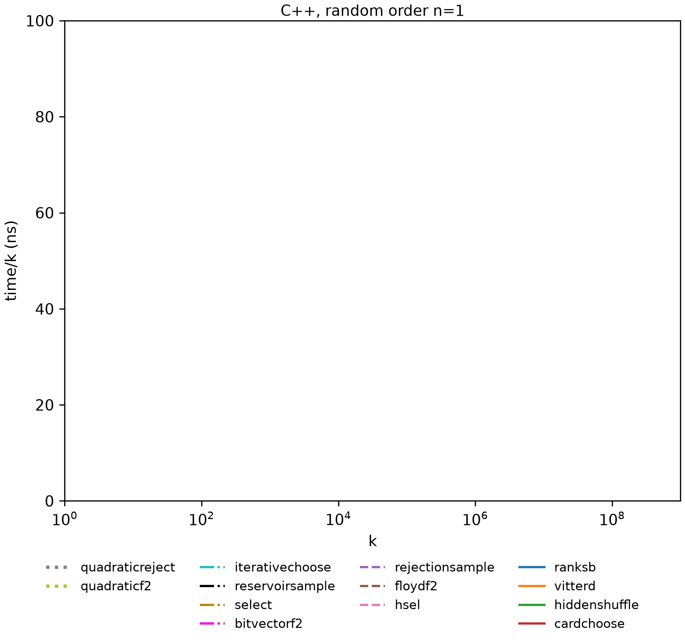
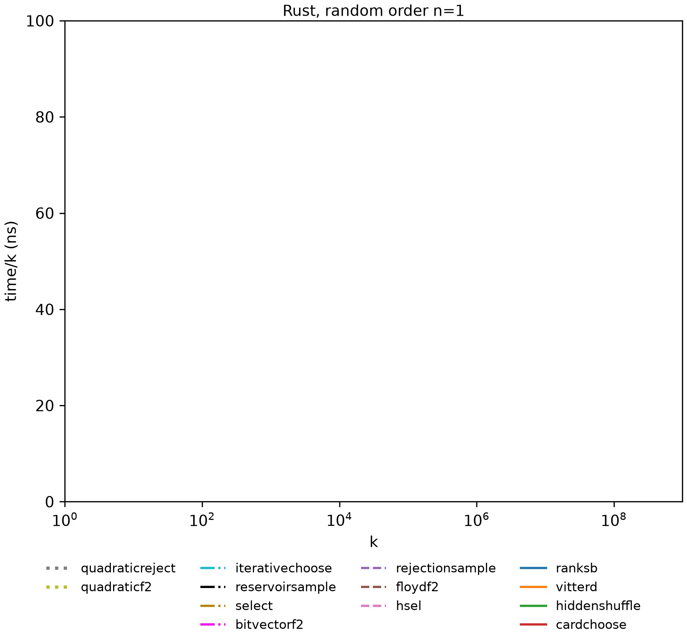
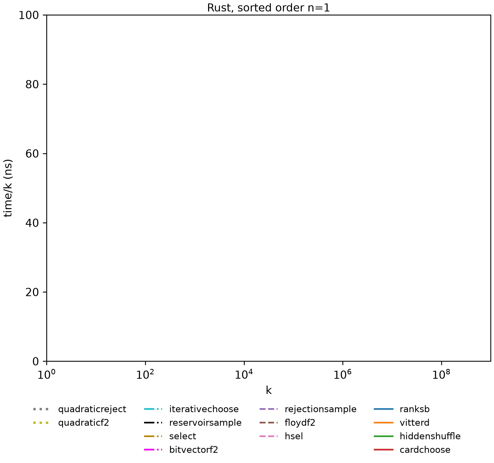

# Results

These results were measured on an AWS r8a.xlarge, whose four vCPUs are each a whole core of an AMD
EPYC 9R45, with 32GiB of memory, running NixOS 25.11, using clang 21.1 with libstdc++ 15 and Boost 1.91, and rustc 1.98,
for values of _n_ and _k_ that are Fibonacci numbers, with _k_ at most 102,334,155 (the 40th
Fibonacci number). [Full results](results/latest/)

Each point, one algorithm at one _n_ and _k_, is timed in a process of its own, and these are the
fastest times of three whole runs; the CSVs record the commit and setup they were timed with, and
the processor's performance counters at every point. [Making the timings
trustworthy](measurement.md) describes what I did so that these times measure the algorithms and
the libraries they use, rather than accidents of memory layout or code generation, and how far to
trust them: differences of less than 5% between two algorithms at a point mean nothing, and
`select`'s times are less certain than the others'.

Since both _n_ and _k_ affect the performance, I compare algorithms using an animated graph. For
each frame, I fix the value of _n_ and graph the performance of each algorithm for various values
of _k_; I graph time/_k_ to show the cost in ns per number output. Since the graph of time/_k_ is
linear/log, the _k_ log _k_ performance of `cardchoose` is visible as a straight line.

I stop timing an algorithm at larger values of _k_ for the same _n_ once a single call takes more
than 30 seconds, and at that _k_ and all larger ones for every later _n_ once that has happened at
the same _k_ for two values of _n_. Only the quadratic algorithms went over the limit, from _k_ =
1.3×106.

## Comparing algorithms

[Choosing algorithms](choosing.md) scores the algorithms by their worst time per number output in
each decade of _k_, gives the best algorithm in each band and the best sets of two or three to
implement together, and makes the case for implementing only `cardchoose`.
[Every algorithm's score in every band](results/latest/by-band.md) gives the full detail.

The region claims below come from [`python/regions`](python/regions), which gives the range of
one algorithm's time over another's, or over the fastest of all the others, in bands of _n_/_k_
and _k_.

## Each pair of algorithms

For every pair of algorithms, the pairwise comparisons give how much slower one is than the other
at its worst, and where, both as a [ratio of times](results/latest/pairwise-ratio.md) and as a
[difference in time/_k_](results/latest/pairwise-difference.md).

## Differences between the languages

The C++ and Rust implementations are the same algorithms, written the same way, from widely used
components: the Rust uses its standard library, with the foldhash crate's hasher for its hash
tables and the `fixedbitset` crate's bit vector, and the C++ takes its sort, hash tables and bit
vector from Boost. Even so, some of those components differ a great deal.
[`python/components`](python/components) times them alone, in ns per number, as the cost of each
operation on _k_ random numbers below 232 − 1 over that of drawing the numbers:

| Length | Sort, C++ | Sort, Rust | Shuffle, C++ | Shuffle, Rust | Hash set insert, C++ | Hash set insert, Rust |
|---:|---:|---:|---:|---:|---:|---:|
| 144 | 11.9 | 5.01 | 0.904 | 1.22 | 4.72 | 4.84 |
| 1,597 | 14.1 | 6.37 | 0.857 | 1.18 | 2.98 | 3.42 |
| 17,711 | 16.2 | 7.53 | 0.858 | 1.18 | 2.26 | 2.98 |
| 196,418 | 18.1 | 8.70 | 0.937 | 1.27 | 3.37 | 3.72 |
| 2,178,309 | 19.9 | 9.87 | 1.11 | 1.66 | 4.95 | 6.36 |
| 24,157,817 | 21.8 | 11.1 | 6.94 | 9.95 | 25.0 | 26.1 |

- **Hash tables.** Boost's `unordered_flat_set` and `unordered_flat_map` and Rust's `HashSet` and
  `HashMap` are all flat open-addressing tables. Rust's hash with SipHash by default, which resists
  collision attacks; Boost's do not, so the Rust's hash with foldhash, with a fixed seed. Inserting
  into the set takes 1.0–1.3× as long in Rust as in C++, and with random output the hash-based
  algorithms, `rejectionsample`, `floydf2` and `hsel`, take 1.08–1.14× as long in Rust, at the
  median. With SipHash, which is what a Rust program gets unless it asks for another hasher,
  inserting into the set takes 1.4–2.2× as long as with foldhash, and at the median
  `rejectionsample` takes 1.83× as long, `floydf2` 1.66× and `hsel` 1.60×. Wherever 100 ≤ _k_ <
  106 and _n_ ≥ 2 _k_ they then take 0.73–1.38× as long as `cardchoose`, and wherever
  _k_ ≥ 107 and _n_ ≥ 2 _k_, 2.5–5.0× as long. These figures are from one run, built
  with the `siphash` feature of the Rust.
- **Sorting.** Boost's `pdqsort` is a pattern-defeating quicksort, and Rust's `sort_unstable` is
  ipnsort, its successor. `pdqsort` takes 1.96–2.4× as long, and `cardchoose` takes about 0.5× as
  long in Rust as in C++. `ranksb`, `vitterd` and `hiddenshuffle` need neither a hash table nor a
  sort, and take about the same time in both languages for sorted output.
- **Random numbers.** Both use the Xoshiro256++ generator, and both turn its output into a number
  below a bound with a multiplication. But the C++ uses its own code for this, which takes two
  32-bit numbers from each 64-bit output, where the `rand` crate's `random_range` uses a whole
  64-bit output for each (see [the random number
  generator](measurement.md#the-random-number-generator)). The shuffle that turns the sorted output
  of `ranksb`, `vitterd` and `hiddenshuffle` into random order is the same loop in both languages,
  but costs 1.3–1.5× as much per number in Rust. So `vitterd` and `hiddenshuffle` take 5–8% longer
  in Rust for random output, at the median. (The `rand` crate's own `SliceRandom::shuffle` is
  slower still.)
- **Searching an array.** The quadratic algorithms check each number they draw against the output
  so far. The Rust uses its standard `slice::contains`. The C++ uses a loop of its own that checks
  every entry rather than stopping at the first match, so that the compiler vectorises it (see
  [searching an array in C++](measurement.md#searching-an-array-in-c)).
- **Bit vectors.** Setting a bit costs about the same in Boost's `dynamic_bitset` and
  `fixedbitset`, but reading the sorted output off the vector is slower with Boost (see [the
  libraries](measurement.md#the-libraries)): sorted `bitvectorf2` takes 0.90× as long in Rust as
  in C++, at the median, and with random output 1.20× as long.

## C++

For sorted output, `bitvectorf2` is the fastest algorithm wherever 2 _k_ ≤ _n_ < 16 _k_ and _k_ <
107, and `hiddenshuffle` wherever _n_ ≥ 256 _k_ and _k_ ≥ 100. Wherever _n_ ≥ 16 _k_
and _k_ ≥ 1000, `cardchoose` takes 1.3–2.3× as long as `hiddenshuffle`, and `ranksb` 1.2–2.6× as
long. `ranksb` slows down as _k_ approaches _n_, where Nijenhuis and Wilf suggest switching to
`iterativechoose`, which they call RKS2.

For random output, `select` is the fastest wherever 2 _k_ ≤ _n_ < 16 _k_ and _k_ <
105. From _n_ of about 8 million, each call maps its array afresh (see
[SELECT](algorithms.md#select)), and it takes up to 7.9× as long as `bitvectorf2`, which is the
fastest at most of the points with larger _k_ there, and at 151 of the 177 points with 16 _k_ ≤
_n_ < 256 _k_. For larger _n_/_k_, `quadraticreject` is the fastest or within 5% of it wherever
_k_ < 100 and _n_ ≥ 65,536 _k_; where _k_ ≥ 100 and _n_ ≥ 256 _k_, `rejectionsample` is the
fastest at 145 of the 231 points, and `bitvectorf2` at most of the rest. The hash-based
algorithms, `rejectionsample`, `floydf2` and `hsel`, are faster than `cardchoose` until their
tables no longer fit in cache: wherever 100 ≤ _k_ < 106 and _n_ ≥ 2 _k_ they take
0.17–0.47× as long, and wherever _k_ ≥ 107 and _n_ ≥ 2 _k_, 1.05–1.7× as long.
`hiddenshuffle` followed by a shuffle takes 0.48–0.78× as long as `cardchoose` wherever _n_ ≥ 16
_k_ and _k_ ≥ 1000.

## Rust

For sorted output, as in C++, `bitvectorf2` is the fastest algorithm wherever 2 _k_ ≤ _n_ < 16
_k_ and _k_ < 107. For larger _n_/_k_ it is `cardchoose`: it is the fastest wherever
_n_ ≥ 256 _k_ and _k_ < 1000, and the fastest or within 14% of it wherever _n_ ≥ 256 _k_.
Wherever _k_ < 1000 and _n_ ≥ 2 _k_, `hiddenshuffle` takes up to 3.8× as long as `cardchoose`;
wherever _n_ ≥ 16 _k_ and _k_ ≥ 1000, `cardchoose` takes 0.63–1.27× as long as `hiddenshuffle`,
which is the faster of the two only for the largest _k_.

For random output, the regions are the same as in C++. `select` is the fastest wherever 2 _k_ ≤
_n_ < 16 _k_ and _k_ < 105, and `bitvectorf2` at 134 of the 177 points with 16 _k_ ≤
_n_ < 256 _k_. `quadraticreject` is the fastest wherever _k_ < 100 and _n_ ≥ 65,536 _k_, and
where _k_ ≥ 100 and _n_ ≥ 256 _k_, `rejectionsample` is the fastest at 143 of the 231 points.
`cardchoose` is closer to the hash-based algorithms than in C++, since its sort is faster:
wherever 100 ≤ _k_ < 106 and _n_ ≥ 2 _k_ they take 0.35–0.89× as long as it does, and
wherever _k_ ≥ 107 and _n_ ≥ 2 _k_, 1.3–2.6× as long.

